# O-view at a glance

What the app looks like, surface by surface, on both platforms and in both themes. Every image on this page is rendered by the app itself from its shared sample states, so the pictures are the shipped surfaces rather than a mock-up. The panel images are the renders the test suite compares pixel by pixel on every change. The sample data is fictional: a plan at 25% of its session window, 3% of its weekly one, and a month of transcripts.

Four surfaces cannot be rendered offscreen and are described in words at the end: the icon sitting in a real taskbar, the flyout docked against it, a balloon notification, and the installer.

## The tray icon

A ring gauge filled in proportion to the 5-hour session window, with the brand "eye" at its centre and no digits. The colour carries the urgency: green below 50%, amber from 50%, red from 70%. At a measured zero the pupil fades with the ring. A grey, unfilled ring with a solid pupil means O-view has no authoritative data, which is a different claim from 0%.

| 0% | 47% | 72% | 91% | estimate only | no data |
|---|---|---|---|---|---|
|  |  |  |  |  |  |
|  |  |  |  |  |  |

The top row is drawn for a dark taskbar, the bottom row for a light one, where the shades are darker so they still read. The exact percentages live in the tooltip: `5h: 47% · resets 16:32 · 7d: 61%`. The estimate-only and no-data icons are drawn identically, as the grey ring; the tooltip tells them apart (`local estimate` or `no usage data`).

## The detail panel

Left-click the icon. The panel follows the desktop's light or dark theme and opens at the taskbar corner on Windows, or the work-area corner on Linux.

| Windows, dark | Windows, light |
|---|---|
| 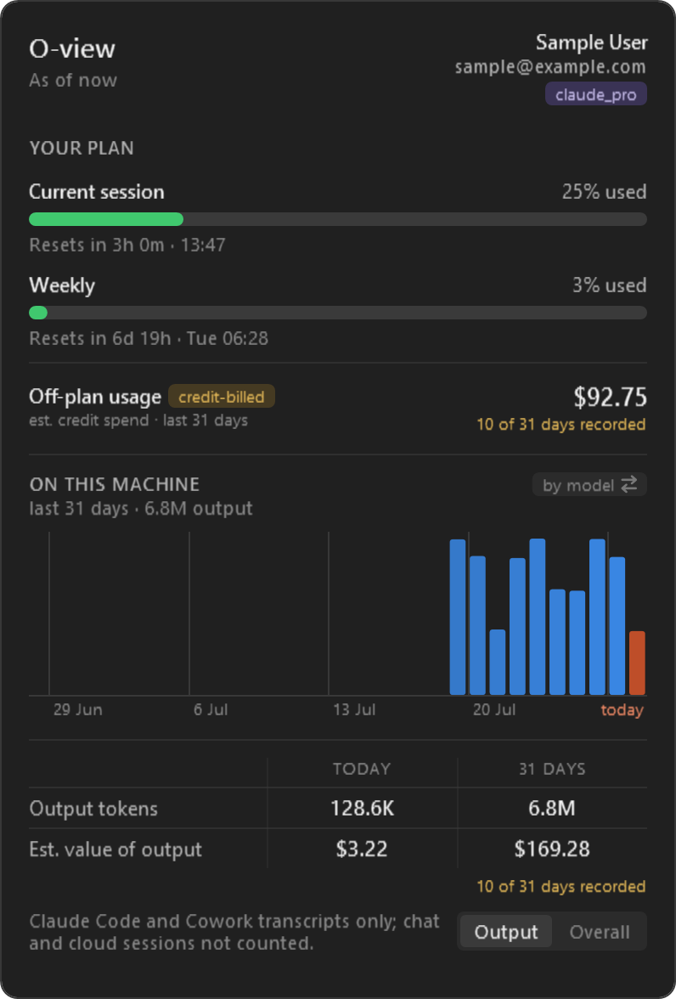 | 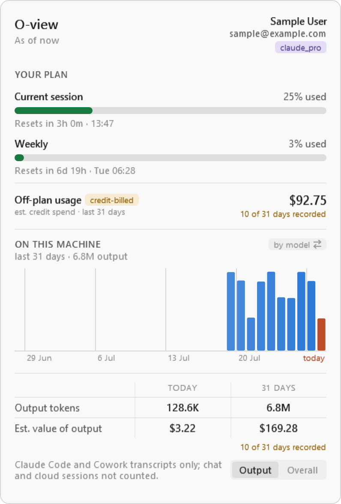 |

From the top: your account and when the figures were captured; the session and weekly bars with their reset times, and under them a `Weekly · <model>` bar for each model limit the account has; four tiles for output tokens and their estimated value, today and over 31 days, with the coverage caveat when O-view has not been installed for the whole window; the tokens-used bars with a legend per kind; the 31-day graph with a dotted line at each weekly reset; and, only while there is off-plan usage to show, the off-plan section. That section is the estimated value of credit-billed models over the chart's window, or, on an account with a model limit, the spend Claude reports, with no period and hidden at zero.

The Linux panel is built from the same sections and the same wording.

| Linux, dark | Linux, light |
|---|---|
| 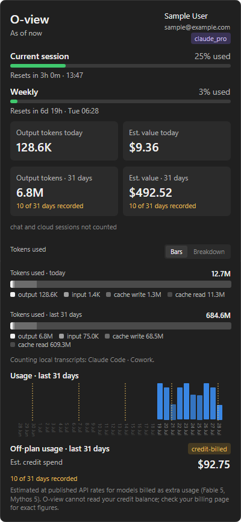 | 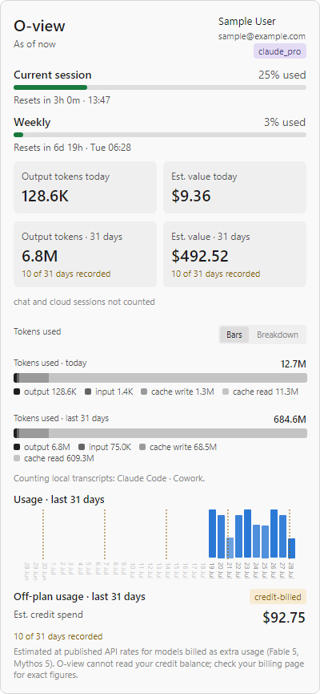 |

### An account with a model limit

An account with a weekly limit on one model, such as Fable on Max, gets that limit as its own bar under Weekly, named for the model, with its own percentage and reset time in the same colours as the other bars. These renders use a sample account with a Fable limit at 58%, on both platforms. An account with no such limit sees no bar and no gap where one would be.

| Windows, dark | Windows, light |
|---|---|
| 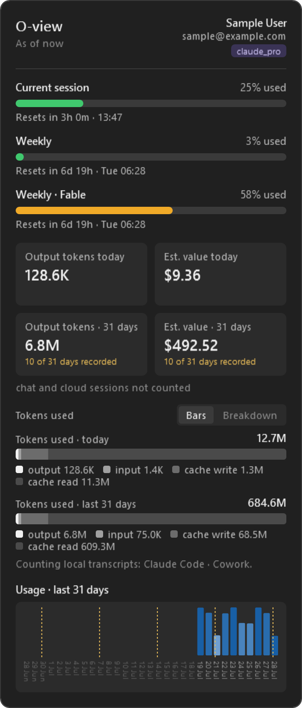 | 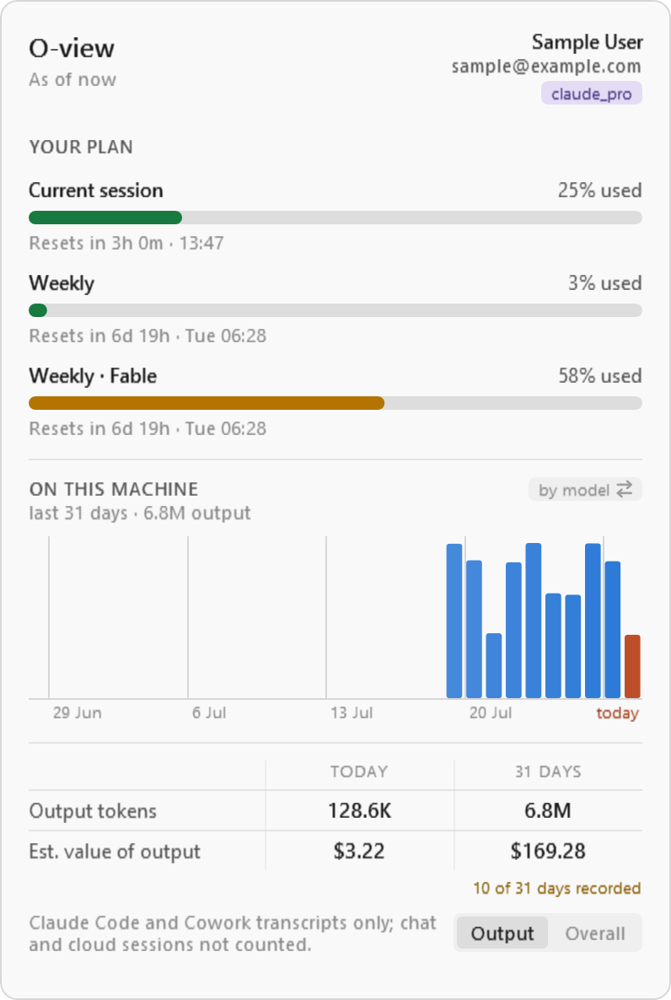 |

| Linux, dark | Linux, light |
|---|---|
| 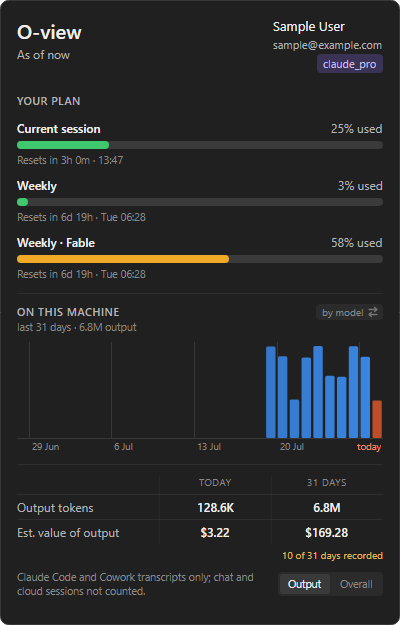 | 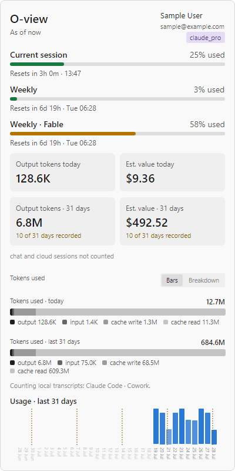 |

### Tiles that flip

Click any tile and it flips to a per-model bar, with the same colour per model across the whole panel. Hovering a segment shows that model's exact figure.

| Summary | Breakdown | Hover cards |
|---|---|---|
| 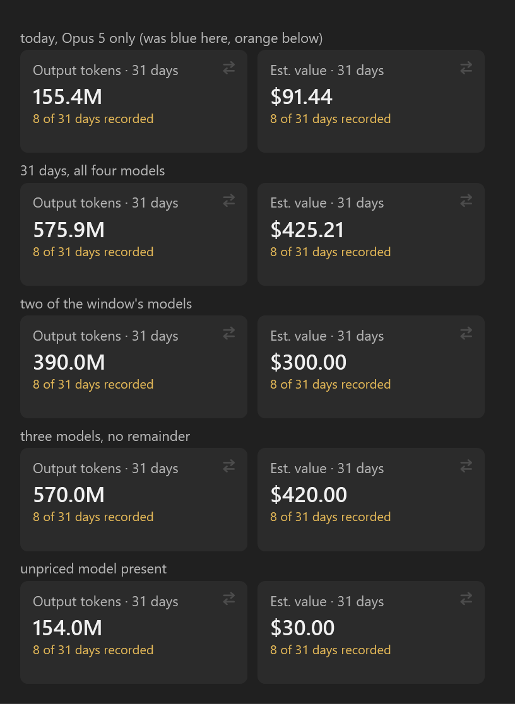 | 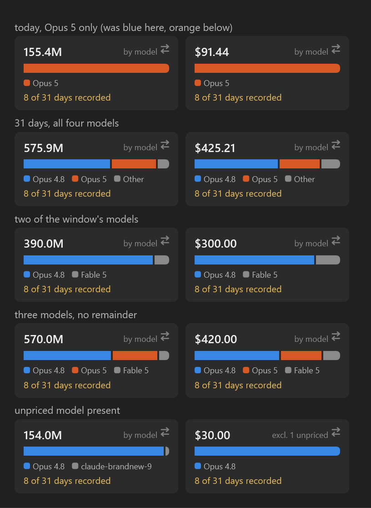 | 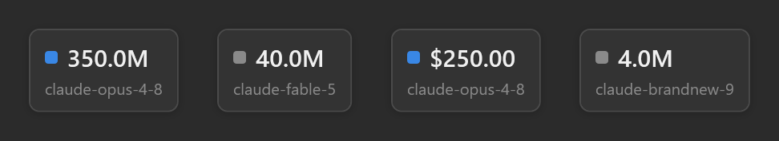 |

### The graph's hover cards

Hovering a day shows its token count and date; hovering a reset line shows the reset time, or says that the line is only a calendar reference while no reset has been reported yet.

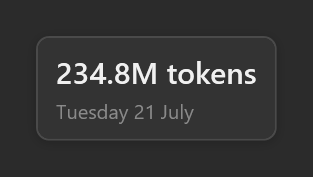

### When something is off

When the plan window is exhausted, or substantial local work runs against a plan meter that is not moving, an amber banner says so. What it claims about billing follows your account's extra-usage setting, as Claude Code last reported it, rather than asserting a charge. When O-view finds nothing to read it says what it checked and what it found.

| Off-plan banner, light | No usage data, dark |
|---|---|
| 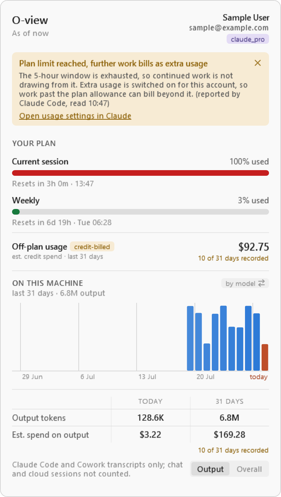 | 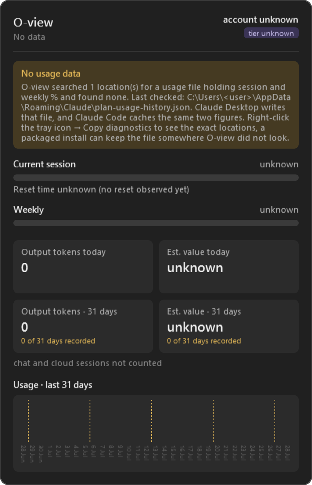 |

### A short display

On a display too short for the full panel the layout compacts first and, if that is still not enough, the panel stops at the edge of the work area and scrolls.

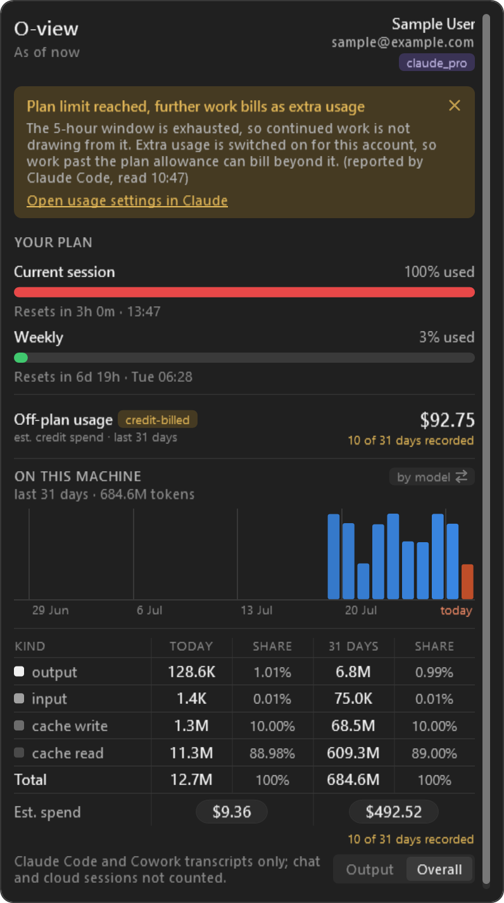

## The menu

Right-click the icon. On Windows it is a flyout docked to the taskbar corner, on the panel's own palette, with a header carrying the mark and the version so a detached window still says what it is. Toggles leave it open so the tick confirms the change; actions close it first.

| Dark | Light, with the threshold selector open |
|---|---|
| 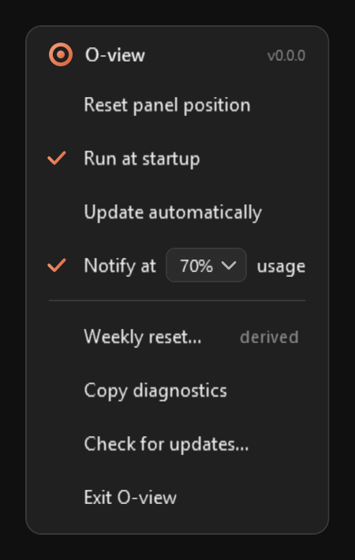 | 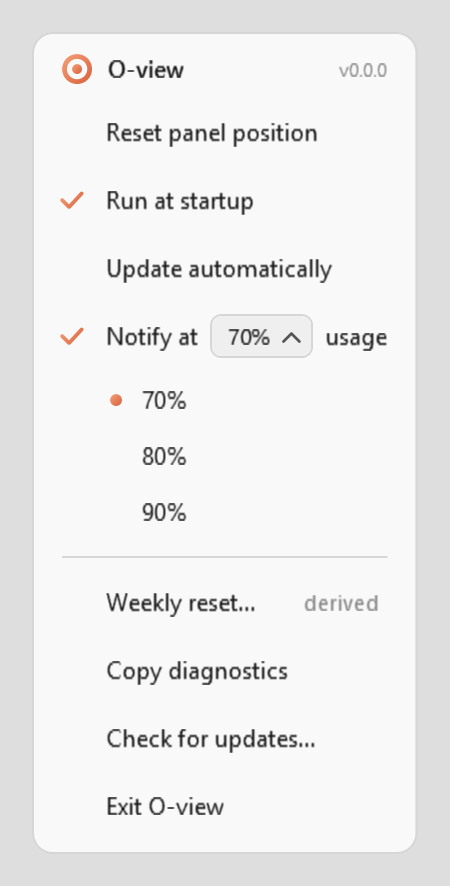 |

On Linux the menu belongs to the desktop's notification-area host and is drawn in its style; its rows are Show usage, Reset panel position, Run at startup, Resume usage refresh when needed, and Exit.

## Dialogs

O-view asks its questions on its own window rather than a system box: the same mark, palette and type as the panel, a primary button that names the action, and an outlined secondary one.

| Update available, dark | Weekly reset entry, light |
|---|---|
| 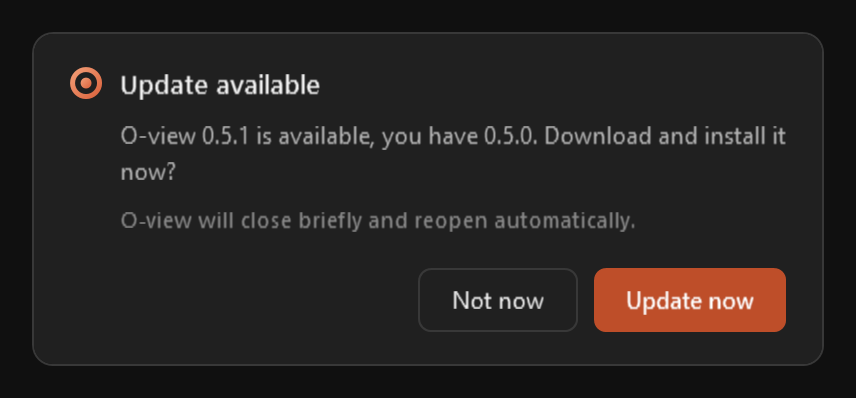 | 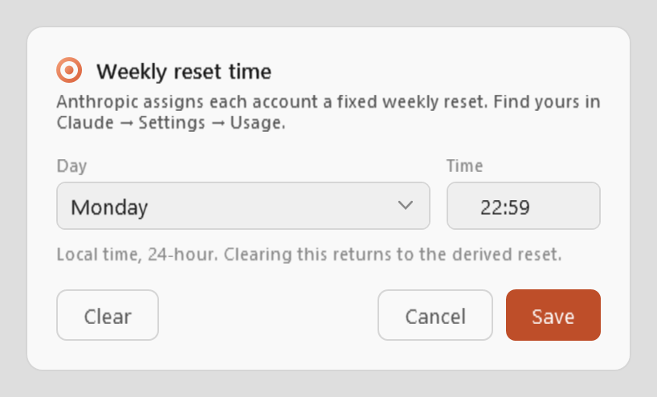 |

## Motion

Still images cannot show it, so it is described here. On Windows the panel and the menu move; on Linux nothing does.

- **The panel and the menu slide.** They slide out of the taskbar edge they are docked to as one piece, in 460 ms, and back in 300 ms. A click while one is moving turns it round from where it had got to.
- **Folds.** The Bars / Breakdown switch's highlight slides between its two labels, and the breakdown table folds open in 400 ms with its rows fading in one after another, closing in 280 ms. The menu's threshold list folds open and closed the same way, in 340 ms and 240 ms.
- **Choosing a threshold shows it first.** The pill updates at once, the chosen dot grows in, and the list folds away about 300 ms later.
- **Ticks and highlights.** A tick draws itself on and fades off, and the hover and focus fill on menu rows and option rows fades in and out.
- **Stat tiles.** The total lifts out, the breakdown rises in behind it, the bar draws from left to right and the legend follows one entry at a time. The tile never changes size.
- **Animations off.** Everything above follows Windows' setting for animation effects, read each time a transition starts. With it off, the panel and the menu appear and disappear at once, and folds and flips happen in one step.

Once the motion has settled the surfaces look as the images above show them. The Linux head has none of this: its panel appears and disappears at once, its tiles and breakdown switch change in one step, and its menu belongs to the desktop. [platform-status.md](platform-status.md) records which of this has been watched on a real desktop.

## What cannot be rendered

These four need a real desktop and are described rather than shown.

- **The icon in the taskbar.** On Windows 11 a new tray icon lands in the overflow flyout behind the `^` chevron; drag it onto the taskbar to pin it. On Linux it appears wherever the desktop's notification area draws it, and on GNOME only once the AppIndicator extension is installed.
- **The flyout against the taskbar.** The panel and the menu slide out of the taskbar edge as one piece on Windows (see Motion above), on curves fitted to the motion of Windows' own quick-settings flyout, and dock 12 px clear of it in the corner nearest the icon.
- **A notification.** A balloon tip on Windows and a desktop notification on Linux, drawn by the system with O-view's title and body, once per session window when usage crosses your threshold, and once per onset when work stops drawing from the plan.
- **The installer.** A per-user Inno Setup wizard with a terracotta panel carrying the mark and wordmark on its welcome and finish pages, an optional start-at-sign-in task, and a Start Menu entry.

## Brand

The mark, the icon and the horizontal lockup are in [`brand/`](../brand/), with `brand/preview.html` showing them at every size.

