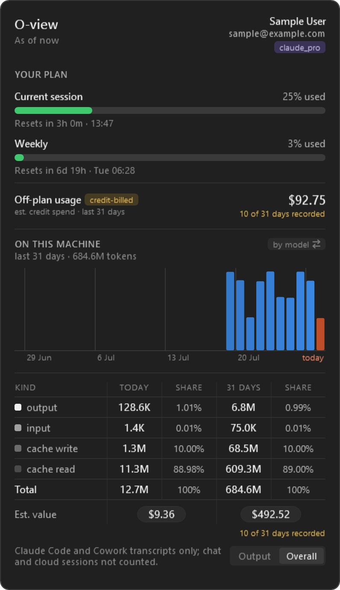
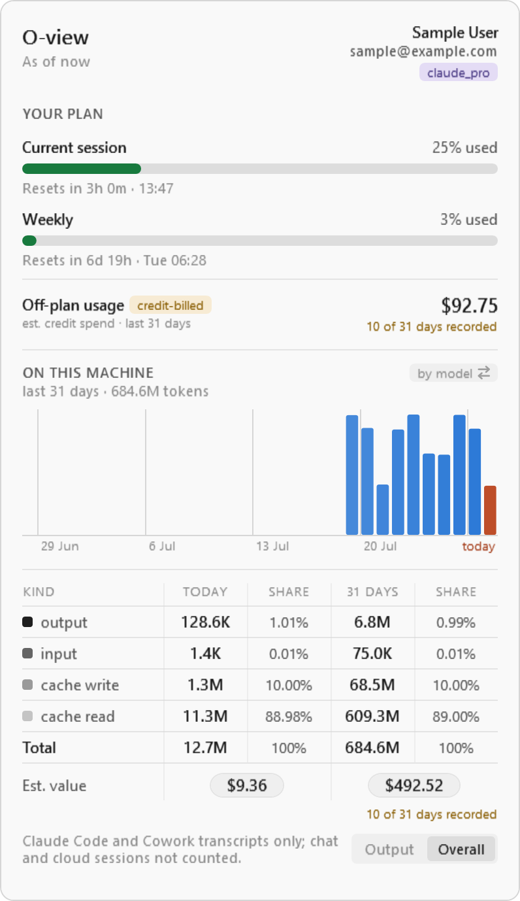
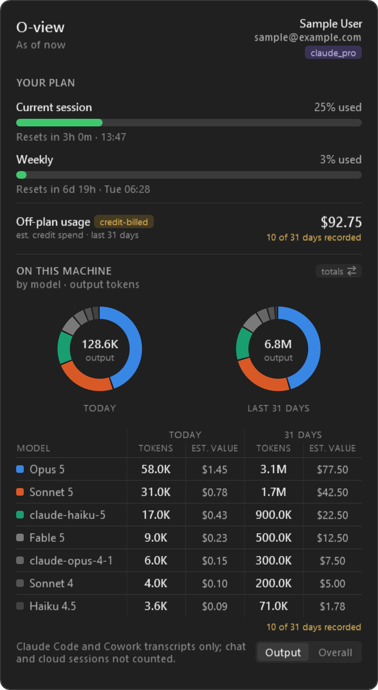
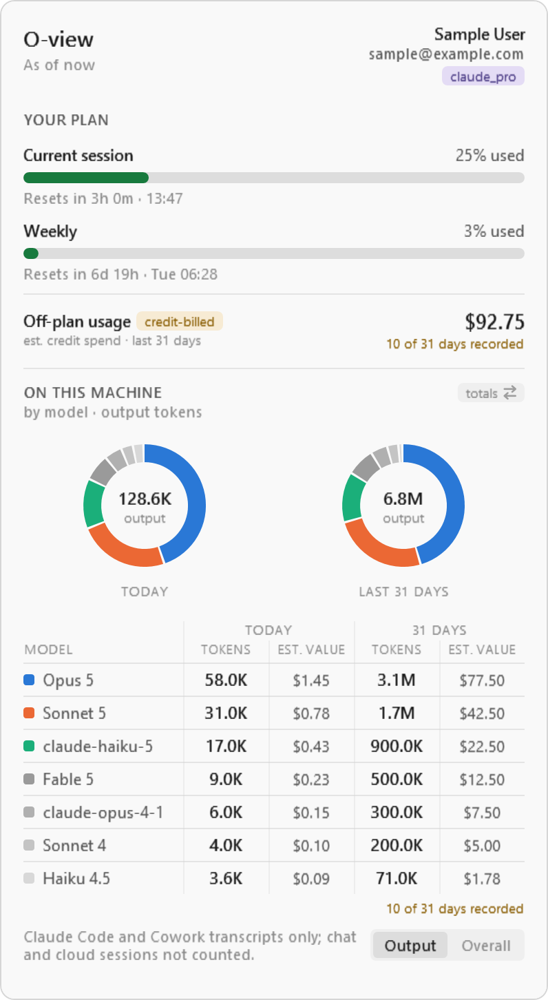

# O-view at a glance

What the app looks like, surface by surface, on both platforms and in both themes. Every image on this page is rendered by the app itself from its shared sample states, so the pictures are the shipped surfaces rather than a mock-up. The panel images are the renders the test suite compares pixel by pixel on every change. The sample data is fictional: a plan at 25% of its session window, 3% of its weekly one, and a month of transcripts.

Four surfaces cannot be rendered offscreen and are described in words at the end: the icon sitting in a real taskbar, the flyout docked against it, a balloon notification, and the installer.

## The tray icon

A ring gauge filled in proportion to the 5-hour session window, with the brand "eye" at its centre and no digits. The colour carries the urgency: green below 50%, amber from 50%, red from 70%. At a measured zero the pupil fades with the ring. A grey, unfilled ring with a solid pupil means O-view has no authoritative data, which is a different claim from 0%.

| 0% | 47% | 72% | 91% | estimate only | no data |
|---|---|---|---|---|---|
|  |  |  |  |  |  |
|  |  |  |  |  |  |

The top row is drawn for a dark taskbar, the bottom row for a light one, where the shades are darker so they still read. The exact percentages live in the tooltip: `5h: 47% · resets 16:32 · 7d: 61%`. The estimate-only and no-data icons are drawn identically, as the grey ring; the tooltip tells them apart (`local estimate` or `no usage data`).

## The detail panel

Left-click the icon. The panel follows the desktop's light or dark theme and opens at the taskbar corner on Windows, or the work-area corner on Linux.

| Windows, dark | Windows, light |
|---|---|
|  |  |

The panel is two blocks flat on one surface, on Windows and on Linux. From the top: your account and when the figures were captured; an amber banner, only while the account is off-plan, which can be hidden; **Your plan**, the session and weekly meters at full width with their reset times, a `Weekly · <model>` meter for each model limit the account has and, only while there is off-plan usage to show, a last row for it; and **On this machine**, the 31-day chart with a hairline and date at every Monday, a table of today's and the 31 days' figures, and beneath them the one caveat about what O-view could not count and an Output | Overall switch. Output counts and prices output tokens alone; Overall counts everything billed, with a share for each kind and a total. The off-plan row is the estimated value of credit-billed models over the chart's window, or, on an account with a model limit, the spend Claude reports, with no period and hidden at zero.

**On Linux** it is the same two blocks, in the same order and with the same wording and figures, laid out by the Linux head. The Linux layout is built and tested; nobody has yet seen it on a Linux desktop, and [platform-status.md](platform-status.md) records what has been. Its chart has the Monday lines and no weekly-reset lines.

| Linux, dark | Linux, light |
|---|---|
|  |  |

### An account with a model limit

An account with a weekly limit on one model, such as Fable on Max, gets that limit as its own bar under Weekly, named for the model, with its own percentage and reset time in the same colours as the other bars. These renders use a sample account with a Fable limit at 58%, on both platforms. An account with no such limit sees no bar and no gap where one would be.

| Windows, dark | Windows, light |
|---|---|
|  |  |

| Linux, dark | Linux, light |
|---|---|
|  |  |

### Output, Overall and the model face

The switch under the table changes what the figures and the chart count. **Output** is the default for a fresh install; **Overall** adds the input and the cache kinds, each with its share, and a total. "By model" at the block's top right turns the whole block over to two doughnuts, today and the last 31 days, and a table with a row for every model, each in the same colour on both rings and in the table; "totals" turns it back. The panel reopens on the view it was left in, also after O-view is quit and started again.

| Overall, dark | Overall, light |
|---|---|
|  |  |

| Model face, dark | Model face, light |
|---|---|
|  |  |

Linux has the same switch, the same "by model" tag and the same model face, and the same view is remembered. The images above are Windows renders. On Linux the block turns and folds the same way.

### The chart's hover cards

Hovering a day shows its token count and date. The chart has no line at the plan's weekly reset: its lines are the calendar's Mondays and carry no hover text. On Linux the bar's hover card has the same shape, the figure with its date beneath, and the image below is a Windows render.

### When something is off

When the plan window is exhausted, or substantial local work runs against a plan meter that is not moving, an amber banner says so. It has a hide control, which a pointer press, Enter or Space works (on Linux Tab reaches it too), and hidden it stays hidden until a new off-plan spell begins. What it claims about billing follows your account's extra-usage setting, as Claude Code last reported it, rather than asserting a charge. When O-view finds nothing to read it says what it checked and what it found.

| Off-plan banner, light | No usage data, dark |
|---|---|
|  |  |

### A short display

On a display too short for the full panel the layout compacts first and, if that is still not enough, the panel stops at the edge of the work area and scrolls.

## The menu

Right-click the icon. On Windows it is a flyout docked to the taskbar corner, on the panel's own palette, with a header carrying the mark and the version so a detached window still says what it is. Toggles leave it open so the tick confirms the change; actions close it first.

| Dark | Light, with the threshold selector open |
|---|---|
|  |  |

On Linux the menu belongs to the desktop's notification-area host and is drawn in its style; its rows are Show usage, Reset panel position (X11 and XWayland only), Run at startup, Notify at, Weekly reset, Resume usage refresh when needed, Copy diagnostics, and Exit. Notify at and Weekly reset offer the choices the Windows rows do, and Weekly reset opens a small window for the day and time. Updates have no row on Linux: they notify only.

## Dialogs

O-view asks its questions on its own window rather than a system box: the same mark, palette and type as the panel, a primary button that names the action, and an outlined secondary one.

| Update available, dark | Weekly reset entry, light |
|---|---|
|  |  |

The images are Windows renders. Linux has the weekly reset dialog too, opened from its menu's Weekly reset row, with the same words and the same rules for what it accepts; it keeps the desktop's own window frame and is not modal.

## Motion

Still images cannot show it, so it is described here. On Windows the panel and the menu move. On Linux the panel moves the same way and the menu does not, because the desktop draws it.

- **The panel and the menu slide.** They slide out of the taskbar edge they are docked to as one piece, in 460 ms, and back in 300 ms. A click while one is moving turns it round from where it had got to.
- **Arriving.** As the panel slides in, the plan bars grow to their percentage and the chart's bars rise from the baseline, or on the model face the doughnuts sweep and the model rows fade in. The figures are the real ones from the first frame.
- **Folds.** The Output | Overall switch's highlight slides between its two labels, the chart's bars move to the other series, and the table folds to its new height in 400 ms growing or 280 ms shrinking, with its rows fading in one after another. Hiding the off-plan banner folds it closed in 280 ms. The menu's threshold list folds open and closed the same way, in 340 ms and 240 ms.
- **Choosing a threshold shows it first.** The pill updates at once, the chosen dot grows in, and the list folds away about 300 ms later.
- **Ticks and highlights.** A tick draws itself on and fades off, and the hover and focus fill on menu rows and option rows fades in and out.
- **The model face.** "By model" and "totals" turn the block over: the old face fades as the new one arrives and the height moves between them. On the model face each doughnut fills as one clockwise sweep and the rows fade in one at a time. Pointing at the block brightens its tag and outlines it faintly.
- **Animations off.** Everything above follows the desktop's setting for animation effects, read each time a transition starts: Windows' own, or on Linux the one the desktop publishes through the XDG portal. With it off, the panel and the menu appear and disappear at once, and folds and turns happen in one step.

Once the motion has settled the surfaces look as the images above show them. A second click during a slide, a fold or a turn reverses it from where it had got to; a second press on the banner's hide control changes nothing. On Linux the panel's content slides while its window stays where it was put, and a desktop that cannot make that window see-through shows the panel at once instead; the menu belongs to the desktop and does not move. [platform-status.md](platform-status.md) records which of this has been watched on a real desktop.

## What cannot be rendered

These four need a real desktop and are described rather than shown.

- **The icon in the taskbar.** On Windows 11 a new tray icon lands in the overflow flyout behind the `^` chevron; drag it onto the taskbar to pin it. On Linux it appears wherever the desktop's notification area draws it, and on GNOME only once the AppIndicator extension is installed.
- **The flyout against the taskbar.** The panel and the menu slide out of the taskbar edge as one piece on Windows (see Motion above), on curves fitted to the motion of Windows' own quick-settings flyout, and dock 12 px clear of it in the corner nearest the icon.
- **A notification.** A balloon tip on Windows and a desktop notification on Linux, drawn by the system with O-view's title and body, once per session window when usage crosses your threshold, and once per onset when work stops drawing from the plan.
- **The installer.** A per-user Inno Setup wizard with a terracotta panel carrying the mark and wordmark on its welcome and finish pages, an optional start-at-sign-in task, and a Start Menu entry.

## Brand

The mark, the icon and the horizontal lockup are in [`brand/`](../brand/), with `brand/preview.html` showing them at every size.

