# O-view at a glance

What the app looks like, surface by surface, on both platforms and in both themes. Every image on this page is rendered by the app itself from its shared sample states, the same renders the test suite compares pixel by pixel on every change, so the pictures are the shipped panel rather than a mock-up. The sample data is fictional: a plan at 25% of its session window, 3% of its weekly one, and a month of transcripts.

Four surfaces cannot be rendered offscreen and are described in words at the end: the icon sitting in a real taskbar, the flyout docked against it, a balloon notification, and the installer.

## The tray icon

A ring gauge filled in proportion to the 5-hour session window, with the brand "eye" at its centre and no digits. The colour carries the urgency: green below 50%, amber from 50%, red from 70%. At a measured zero the pupil fades with the ring. A grey, unfilled ring with a solid pupil means O-view has no authoritative data, which is a different claim from 0%.

| 0% | 47% | 72% | 91% | estimate only | no data |
|---|---|---|---|---|---|
|  |  |  |  |  |  |
|  |  |  |  |  |  |

The top row is drawn for a dark taskbar, the bottom row for a light one, where the shades are darker so they still read. The exact percentages live in the tooltip: `5h: 47% · resets 16:32 · 7d: 61%`.

## The detail panel

Left-click the icon. The panel follows the desktop's light or dark theme and opens at the taskbar corner on Windows, or the work-area corner on Linux.

| Windows, dark | Windows, light |
|---|---|
| 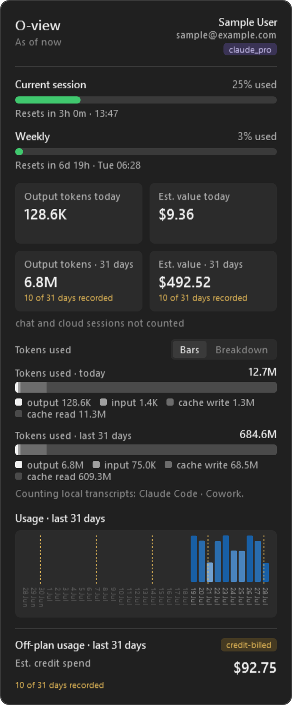 | 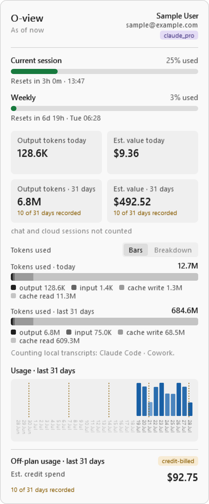 |

From the top: your account and when the figures were captured; the session and weekly bars with their reset times; four tiles for output tokens and their estimated value, today and over 31 days, with the coverage caveat when O-view has not been installed for the whole window; the tokens-used bars with a legend per kind; the 31-day graph with a dotted line at each weekly reset; and the off-plan section.

The Linux panel is built from the same sections and the same wording.

| Linux, dark | Linux, light |
|---|---|
| 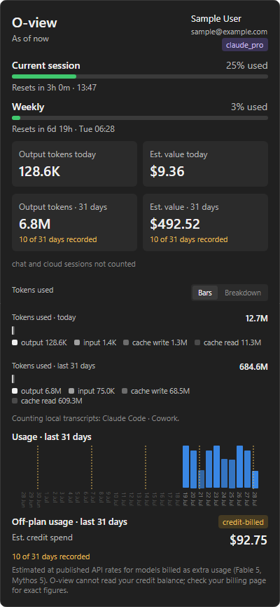 | 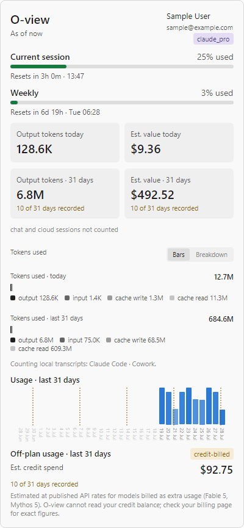 |

### Tiles that flip

Click any tile and it flips to a per-model bar, with the same colour per model across the whole panel. Hovering a segment shows that model's exact figure.

| Summary | Breakdown | Hover cards |
|---|---|---|
| 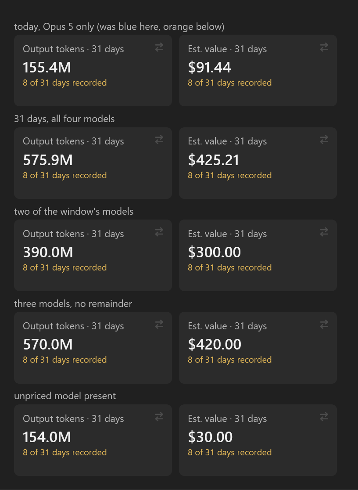 | 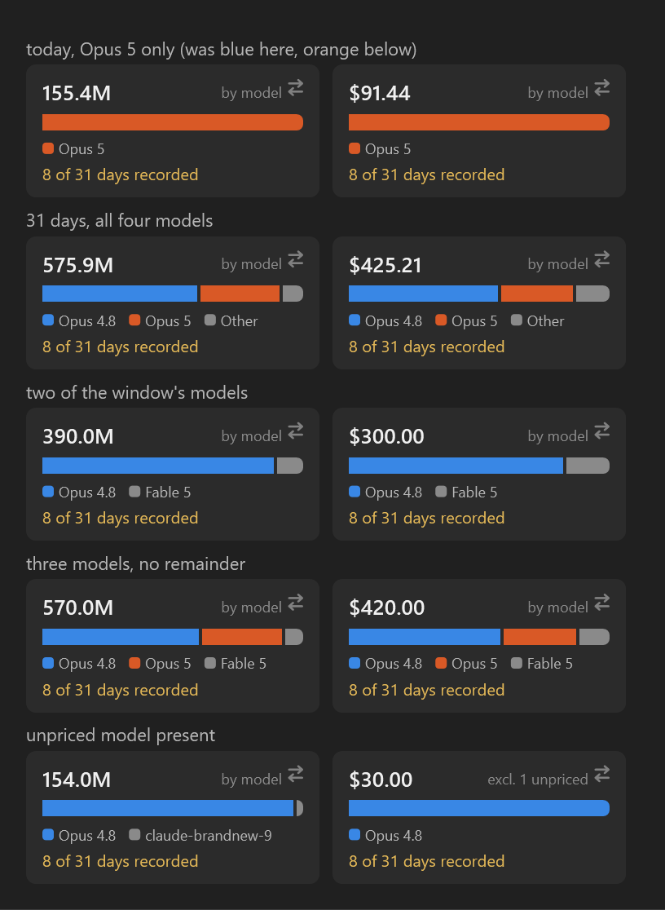 | 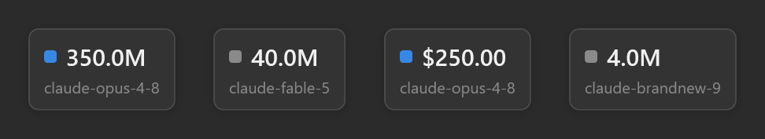 |

### The graph's hover cards

Hovering a day shows its token count and date; hovering a reset line shows the reset time, or says that the line is only a calendar reference while no reset has been reported yet.

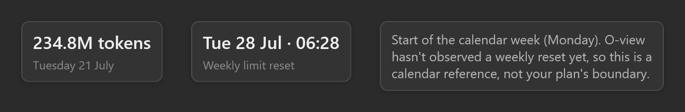

### When something is off

When the plan window is exhausted, or substantial local work runs against a plan meter that is not moving, an amber banner says so. What it claims about billing follows your account's extra-usage setting, as Claude Code last reported it, rather than asserting a charge. When O-view finds nothing to read it says what it checked and what it found.

| Off-plan banner, light | No usage data, dark |
|---|---|
| 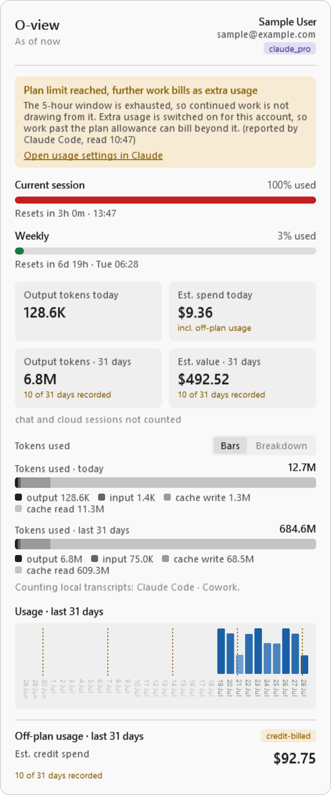 | 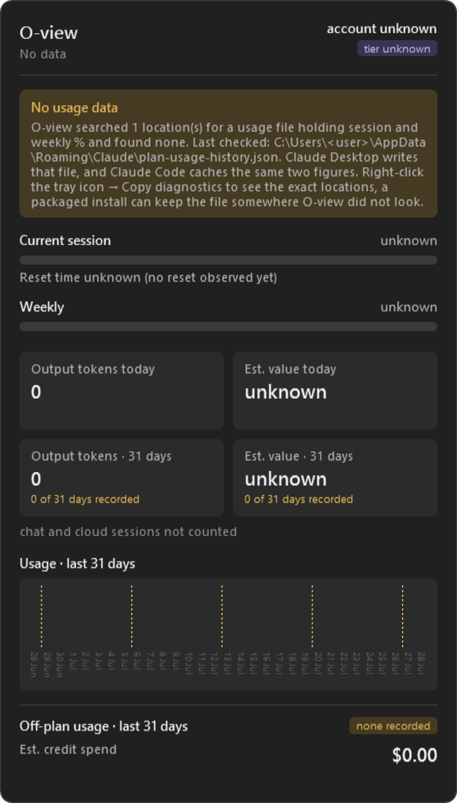 |

### A short display

On a display too short for the full panel the layout compacts first and, if that is still not enough, the panel stops at the edge of the work area and scrolls.

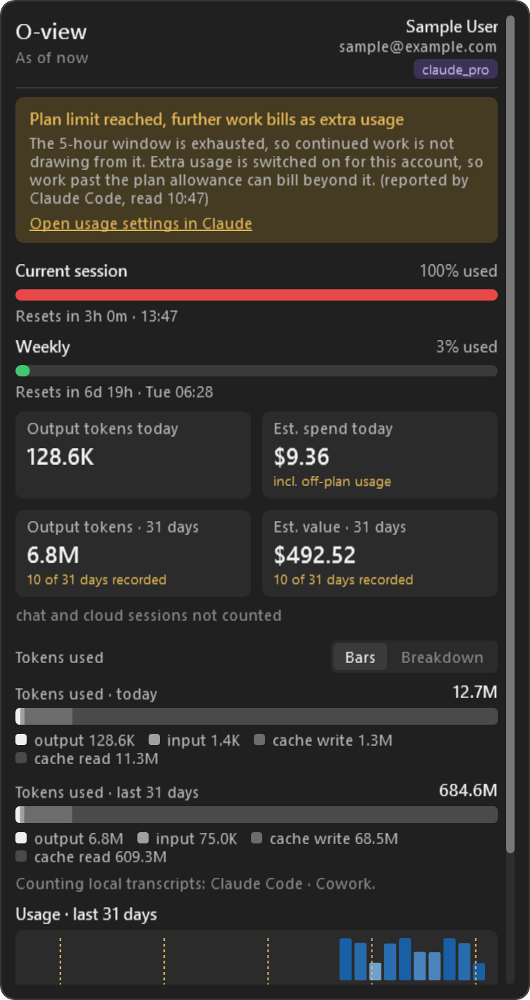

## The menu

Right-click the icon. On Windows it is a flyout docked to the taskbar corner, on the panel's own palette, with a header carrying the mark and the version so a detached window still says what it is. Toggles leave it open so the tick confirms the change; actions close it first.

| Dark | Light, with the threshold selector open |
|---|---|
| 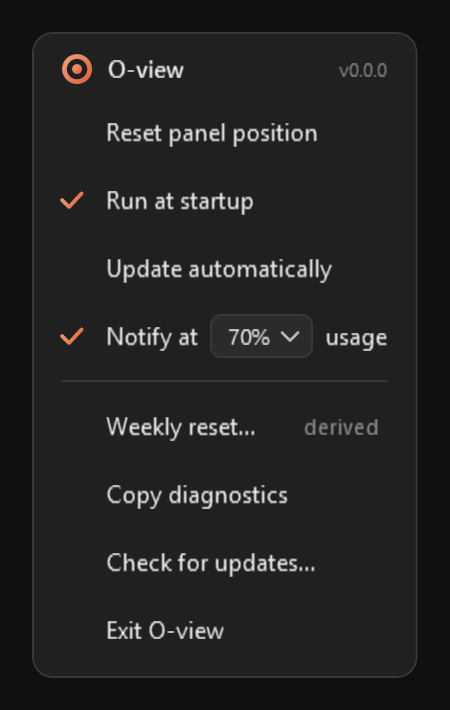 | 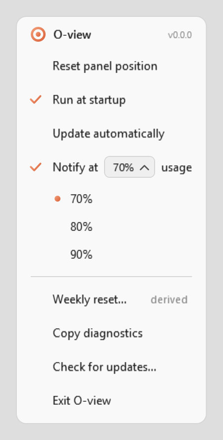 |

On Linux the menu belongs to the desktop's notification-area host and is drawn in its style; its rows are Show usage, Reset panel position, Run at startup, Resume usage refresh when needed, and Exit.

## Dialogs

O-view asks its questions on its own window rather than a system box: the same mark, palette and type as the panel, a primary button that names the action, and an outlined secondary one.

| Update available, dark | Weekly reset entry, light |
|---|---|
| 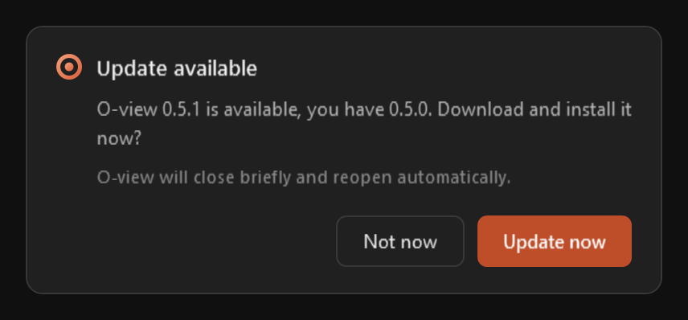 | 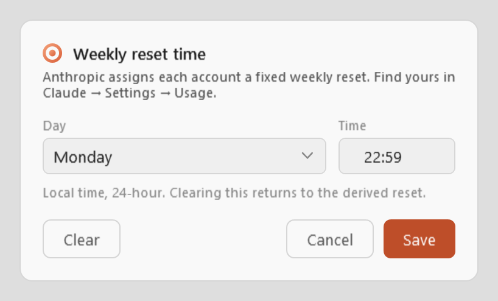 |

## What cannot be rendered

These four need a real desktop and are described rather than shown.

- **The icon in the taskbar.** On Windows 11 a new tray icon lands in the overflow flyout behind the `^` chevron; drag it onto the taskbar to pin it. On Linux it appears wherever the desktop's notification area draws it, and on GNOME only once the AppIndicator extension is installed.
- **The flyout against the taskbar.** The panel and the menu rise out of the taskbar edge over 230 ms on Windows, fitted to the motion of Windows' own quick-settings flyout, and dock 12 px clear of it in the corner nearest the icon.
- **A notification.** A balloon tip on Windows and a desktop notification on Linux, drawn by the system with O-view's title and body, once per session window when usage crosses your threshold, and once per onset when work stops drawing from the plan.
- **The installer.** A per-user Inno Setup wizard with a terracotta panel carrying the mark and wordmark on its welcome and finish pages, an optional start-at-sign-in task, and a Start Menu entry.

## Brand

The mark, the icon and the horizontal lockup are in [`brand/`](../brand/), with `brand/preview.html` showing them at every size.

